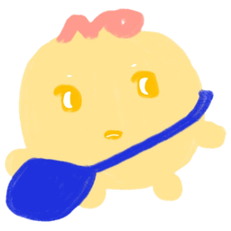

<p align="center"></p>

# frownie

A little creature that walks onto your screen whenever you frown at your computer.
It stays and cheers you on until you relax, then hops happily and walks off.

- Runs as a transparent, click-through, always-on-top overlay, so it walks over
  whatever you're doing without getting in the way.
- Uses your webcam with [MediaPipe Face Landmarker](https://ai.google.dev/edge/mediapipe/solutions/vision/face_landmarker)
  blendshapes (brow furrow, mouth frown). **Everything runs locally. No video
  ever leaves your machine.**
- Learns your resting face for a couple of seconds at startup, so it reacts
  to *your* frown and not to how your eyebrows sit normally.

## Run it

Requires Node.js 18+.

```sh
npm install     # also downloads the 3.8 MB face model into models/
npm start       # desktop overlay (Electron)
```

Look for the creature in your system tray / menu bar. Its menu has:

| Item | What it does |
| --- | --- |
| Summon / dismiss creature | Bring it out by hand (good for testing) |
| Recalibrate neutral face | Relax your face for ~2.5 s while it re-learns |
| Pause (turn camera off) | Releases the webcam completely |
| Show debug panel | Camera preview plus live frown score and thresholds |

On macOS you'll be asked for camera permission the first time.

### Try it in a browser instead

```sh
npm run web     # then open http://localhost:5173
```

Keys: **S** summon, **D** debug panel, **C** recalibrate, **P** pause.
Add `?debug` to the URL to open with the debug panel showing.

## Tuning

If it's too eager or too shy, open the debug panel, watch the score bar while
you frown, and adjust. Any of these can be passed as a flag (`npm start -- --threshold=0.2`)
or as a URL parameter in the browser (`?threshold=0.2`):

| Option | Default | Meaning |
| --- | --- | --- |
| `threshold` | `0.3` | Score above your resting face that counts as a frown (white mark on the bar) |
| `releaseThreshold` | `0.15` | Score you have to drop below for the frown to be over (blue mark) |
| `holdMs` | `1000` | How long a frown has to last before the creature comes |
| `releaseMs` | `2000` | How long you have to stop frowning before it leaves |
| `smoothing` | `0.35` | How fast the score follows your face (higher = twitchier) |
| `calibrationMs` | `2500` | How long it watches your resting face at startup |

## How it works

```
webcam ─▶ FaceLandmarker (12 fps) ─▶ rawFrownScore ─▶ FrownTracker ─▶ Creature
          renderer/detector.js       renderer/frown.js                renderer/creature.js
```

- **`rawFrownScore`** takes the larger of the brow-down and mouth-frown
  blendshapes and subtracts smiling, since laughing also squints your brows down.
- **`FrownTracker`** subtracts your calibrated baseline and smooths the score.
  It fires `start` only after a frown has held for `holdMs` and `end` after
  you've relaxed for `releaseMs`. The gap between the two thresholds keeps it
  from flickering. If your face leaves the frame, the score decays, so the
  creature wanders off.
- **`Creature`** is a hand-drawn sprite (`assets/creature.png`) with CSS
  animations for waddling, breathing, blinking and hopping. It picks a random
  side of the screen and walks in. If you frown again while it's leaving, it
  turns around and comes back.
- **`main.js`** creates the Electron overlay window and the tray, and serves
  the app from a private `app://` protocol so ES modules and the WASM model
  load as they would from a web server.

## Use your own drawing

Draw the creature facing right on a plain white background, then:

```sh
pip install pillow numpy
python3 scripts/make-sprite.py my-drawing.jpg   # writes assets/creature.png
```

The script removes the background, keeping white highlights inside the drawing.
If the new drawing has a different shape, update `aspect-ratio` in
`renderer/style.css`. Then move the two `.eyelid` patches in
`renderer/creature.js` over the eyes so the blink lines up.

## Tests

```sh
npm test
```
